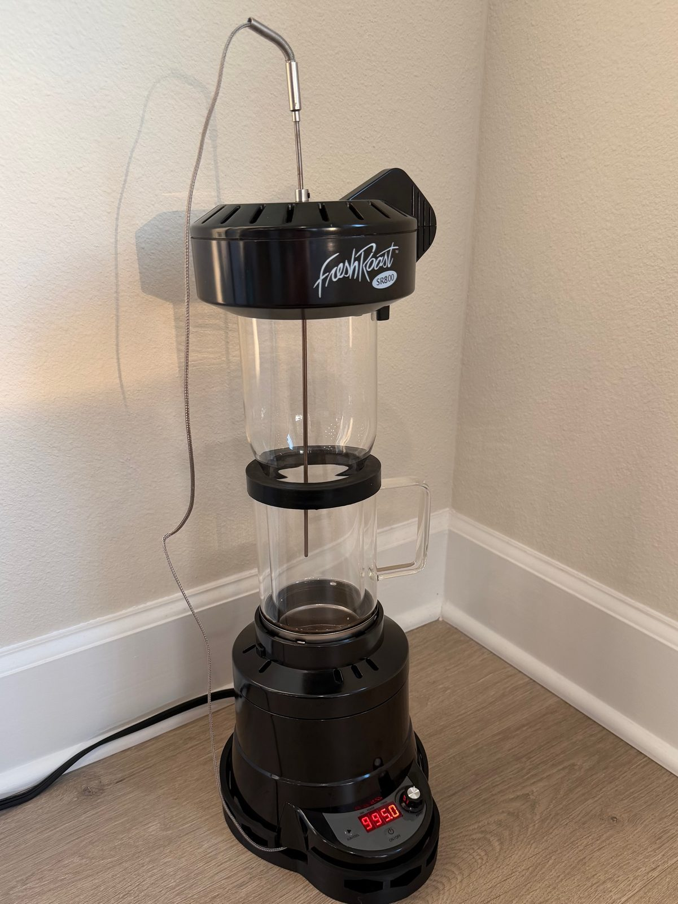
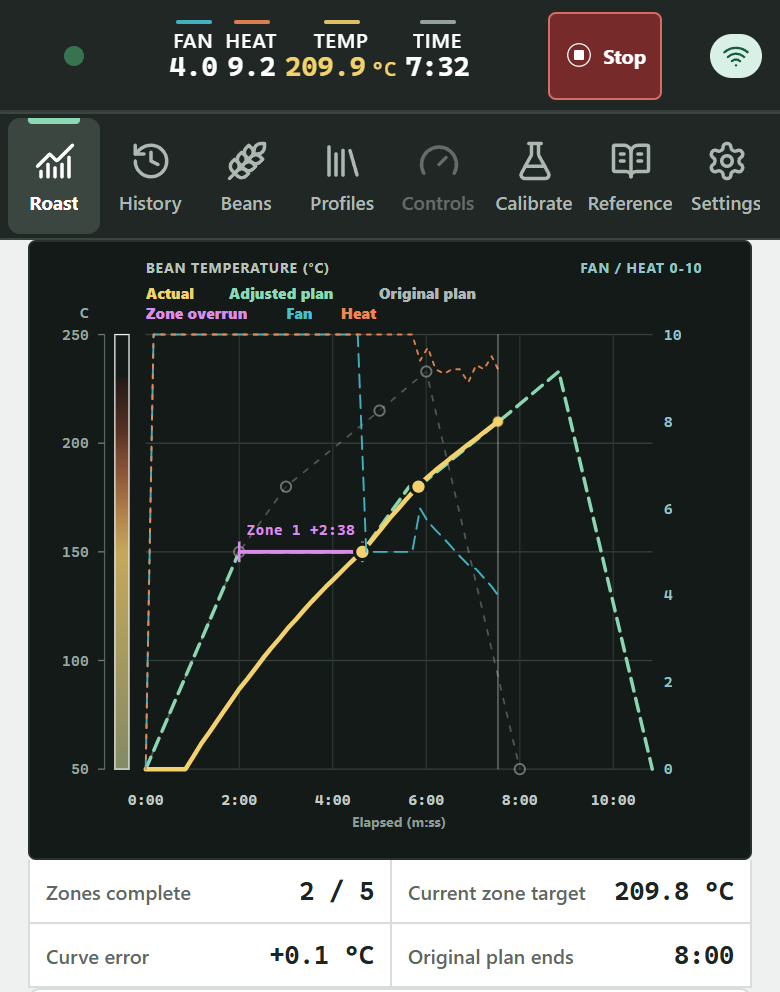
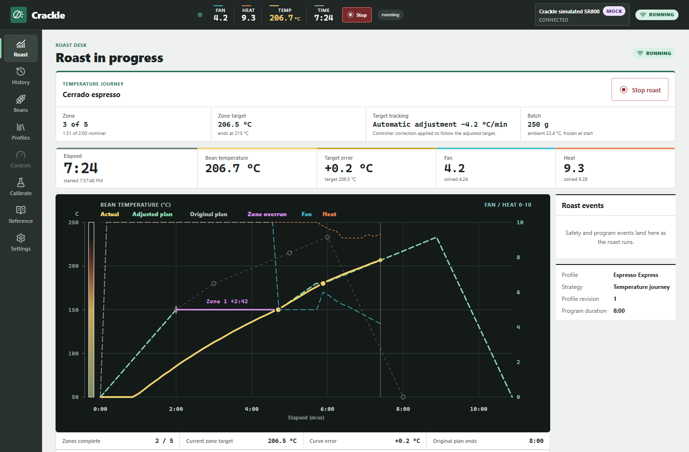
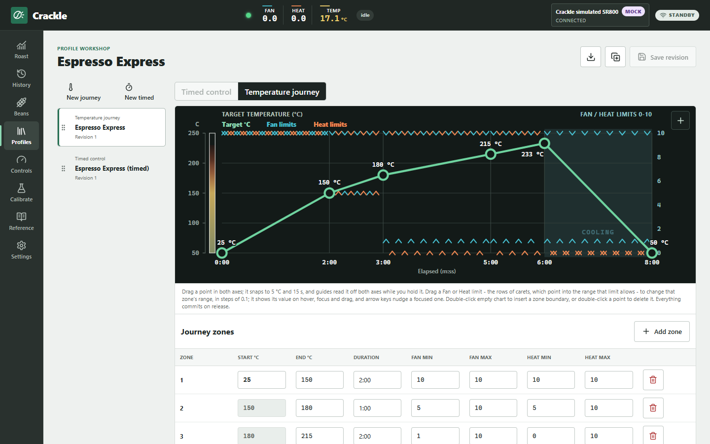
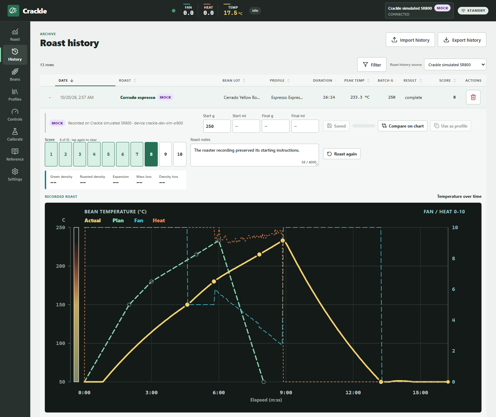
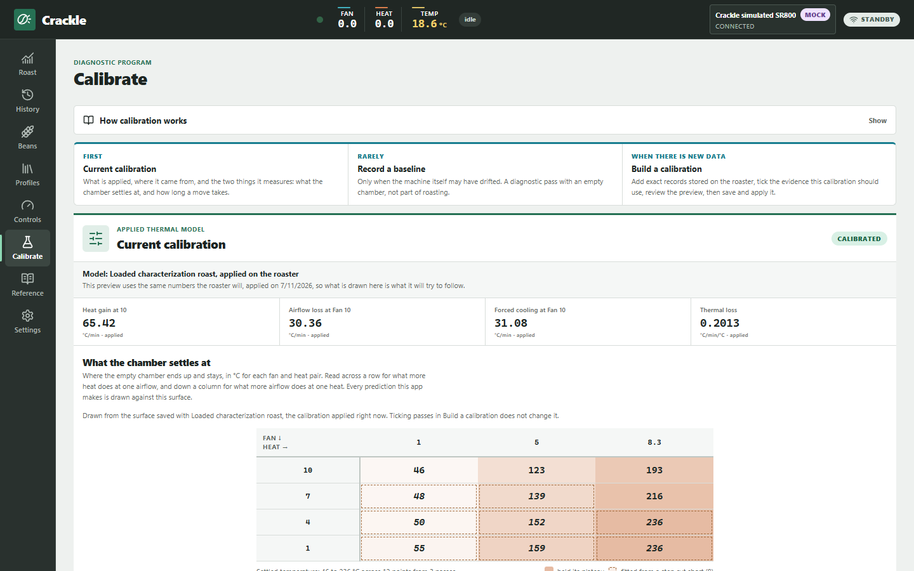
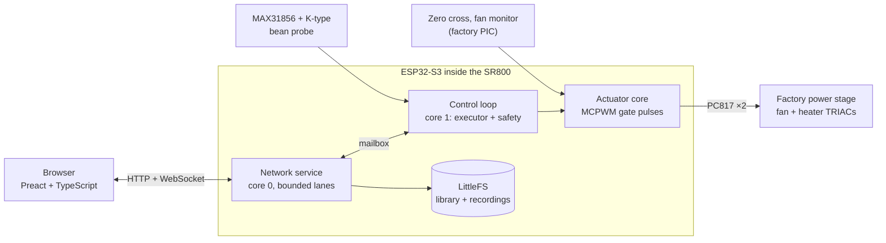
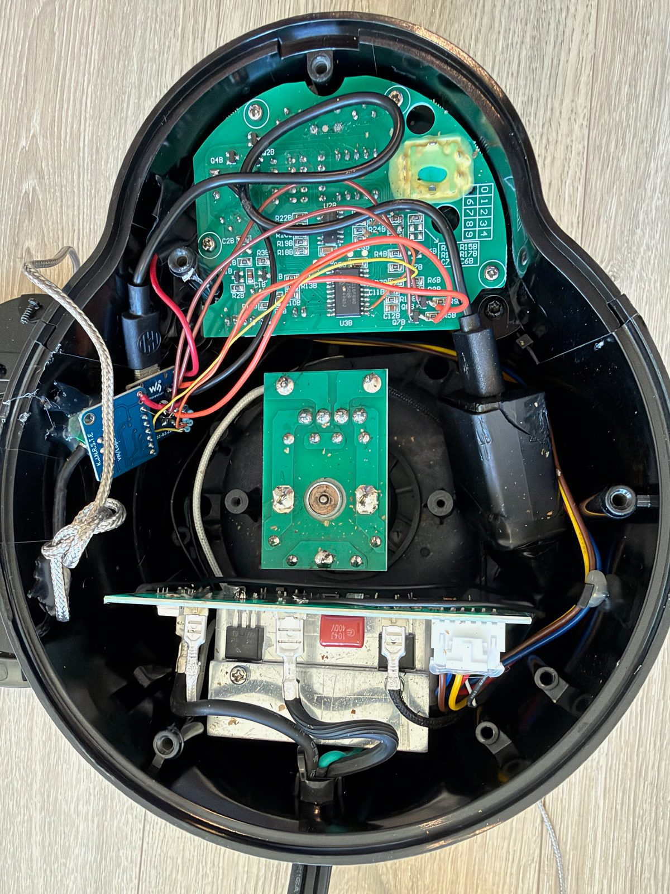

# Crackle

**An add-on controller for the Fresh Roast SR800 coffee roaster: temperature-guided roasts executed
on the roaster itself, planned and monitored from your phone.**

[](https://github.com/triwebb1/crackle/actions/workflows/ci.yml)
[](LICENSE)

<p align="center">
  
  &nbsp;&nbsp;
  
</p>

<p align="center"><sub>An SR800 with Crackle installed, and a temperature-guided roast in progress, monitored on a phone.</sub></p>

## At a glance

| | |
| --- | --- |
| **What it is** | A do-it-yourself add-on controller for the Fresh Roast SR800 home coffee roaster |
| **Capabilities** | Bean-temperature measurement, closed-loop temperature profiles, on-device roast history, and a thermal model calibrated to the individual roaster |
| **Interface** | A web app served by the controller to any phone or browser on the local network. No installation, and no computer attached during a roast |
| **Hardware** | ESP32-S3, MAX31856 thermocouple converter, K-type probe, and two optocouplers. About $38 in parts; no factory wiring is cut |
| **Factory controls** | Remain fully functional. Using them disables Crackle until the roaster is power-cycled |
| **Software** | C++ firmware (ESP-IDF / Arduino core), Preact and TypeScript web app, about 2,000 automated tests |
| **Status** | A personal project in everyday use, developed spec-first. Not reviewed or hardened for production ([details](#status)) |

## What it does

The Fresh Roast SR800 is a widely used countertop hot-air coffee roaster. Its stock controls set fan
speed, heater power, and a timer manually. It does not measure bean temperature and cannot execute a
roast profile, so consistent results depend on continuous observation and manual adjustment.

Crackle is a do-it-yourself modification for home coffee roasting. It adds an ESP32-S3 controller
inside the roaster's base and a K-type thermocouple bean probe through the chamber lid. The
controller serves its own web app to any phone or computer on the local Wi-Fi network; no computer,
USB connection, or Artisan setup is required during a roast. Its capabilities:

- **Temperature-guided profiles.** A profile is a sequence of temperature targets, for example
  150 °C at two minutes and 180 °C one minute later. The controller samples bean temperature and
  rate of rise (RoR) once per second and adjusts Fan and Heat to track the plan. Timed Fan/Heat
  schedules and manual roasts are also supported.
- **Execution independent of the browser.** The roast runs entirely on the controller. A phone can
  sleep or close the page without affecting it, and any device can rejoin the live roast. As with
  any roaster, the operator should remain present throughout.
- **On-device roast history.** Each roast is stored on the controller with its temperature curve,
  bean, batch size, notes, and a 1–10 score, so roasts can be compared and reproduced.
- **Per-roaster calibration.** A thermal model is fitted to the roaster's own recorded roasts, so
  profile previews reflect the behavior of that specific machine.
- **Layered safety.** Fan must be running before Heat is applied and whenever Heat is on. Heat is
  removed immediately on Stop and within one second of a temperature-sensor fault. A bean
  temperature of 260 °C latches Heat off until the controller is power-cycled and starts a full-fan
  cooldown.

**The factory controls remain available.** Crackle is wired alongside the roaster's own control
board, which is neither modified nor removed, so the roaster can still be operated manually at any
time. When the factory controls start the fan, Crackle aborts any running program, releases its
outputs, and stays disabled until the roaster is unplugged and reconnected, so the two controllers
never act at once. No wiring is cut; with Crackle idle or unpowered, the SR800 operates exactly as
shipped.

A new installation includes two profiles: **Espresso Express**, a fast temperature journey (the
app's term for a temperature-guided profile) to a dark espresso roast, and **Espresso Express
(timed)**, a lighter espresso roast on a fixed schedule for 150–200 g batches.

## Screens

| | |
| --- | --- |
|  |  |
| **Live roast.** The first zone took longer than planned (pink bar), so the remaining plan was shifted; the controller corrects Fan and Heat every second to track the adjusted plan. | **Profile editor.** Temperature targets and Fan/Heat limits are edited directly on the chart; the preview runs the same control law the controller executes. |
|  |  |
| **History.** Each roast with its recorded curve, the Fan and Heat levels applied, and its batch, bean, and score. | **Calibration.** The thermal model fitted to this roaster and the temperatures it predicts for each Fan and Heat setting. |

The interface is also designed for phones, with live readings, Stop, and the plan usable one-handed
beside the roaster. The screenshots were captured from the built-in
[mock controller](#try-it-without-a-roaster), whose simulated roaster intentionally differs from the
controller's model.

## How it works



The browser submits a complete roast plan and from then on only observes. The firmware verifies
airflow, executes the program against bean temperature, records the roast, and persists the
recording once the outputs are off. Key design points:

- **Non-destructive hardware interface.** The factory controller fires the fan and heater TRIACs
  with short trigger pulses timed to the mains zero crossing. Crackle reproduces those pulses
  through two optocouplers wired in parallel with the factory driver transistors, identified
  through in-circuit logic captures. [How the SR800 was reverse engineered →](hardware/reverse-engineering.md)
- **Hardware-timed phase control.** MCPWM comparators synchronized to the zero crossing generate
  every 100 µs gate pulse (0–2 µs measured phase error), audited by an independent PCNT edge count.
  No interrupt handler sits in the timing path.
- **Closed-loop temperature journeys.** Per-zone model inversion with PI and lag-compensated rate
  feedback at 1 Hz; each zone ends when its temperature is reached, not after a fixed time. The
  control law is written once in TypeScript and ported to C++, and the port is verified against
  7,304 generated cross-language steps. [Control and calibration →](docs/control-and-calibration.md)
- **Conservative calibration.** The thermal model is fitted to recorded roasts by deterministic
  multi-start search. When the evidence cannot determine the coefficients, the fit is declined with
  guidance rather than reported.
- **Controller-owned data.** Profiles, bean lots, calibrations, and roast records are
  revision-checked documents in the controller's flash, and recordings are compact, CRC-checked
  binary archives. Every browser sees the same library, and no essential state is held in a browser.
- **Safety beneath every command path.** Fan before Heat, airflow floors with Heat, immediate
  Heat-off, sensor-freshness and over-temperature latches, a manual-use interlock, and firmware
  leases. No safety rule depends on a browser remaining connected.
  [Safety policy →](firmware/safety-policy.md)
- **Bounded, concurrent networking.** A native ESP-IDF server on its own core, with separate lanes
  for commands, Stop, assets, storage, and A/B OTA updates, plus a WebSocket stream of snapshots
  and deltas. [Architecture →](docs/architecture.md)

## The hardware

> [!CAUTION]
> This project modifies a mains-powered heating appliance. The controller shares the roaster's
> factory logic ground, which is potentially mains-referenced: **never connect a computer, serial
> adapter, or grounded instrument to it while the roaster is plugged in.** Work on mains equipment
> only if you are qualified to do so. Never leave a roast unattended: chaff and beans can ignite.
> Anyone who builds this assumes responsibility for the result; see the [license](LICENSE) for the
> warranty disclaimer.

The SR800's front-panel board carries a PIC16F690 that runs the stock interface. Two of its pins
drive the fan and heater trigger pulses, and a third carries the mains zero-cross reference. Crackle
interfaces with those signals without removing the board or modifying its firmware. The interface
was developed from three sources of evidence: a battery-powered sniffer that decoded the display
bus, logic captures that identified the trigger outputs, and acoustic analysis of the blower that
matched the factory fan speeds. The raw evidence is preserved in [`data/`](data/README.md).

<p align="center">
  
</p>

<p align="center"><sub>Inside the base: the ESP32-S3-Zero and MAX31856 (left), wired to the front-panel board (top),
which remains in place.</sub></p>

| Guide | Contents |
| --- | --- |
| [Reverse engineering](hardware/reverse-engineering.md) | How the electronics were studied and how the interface was chosen |
| [Power-stage interface](hardware/power-stage-interface.md) | Measured signals and the optocoupler interface |
| [Installation](hardware/installation.md) | Parts, wiring, pin map, thermocouple mounting, first flash, commissioning |
| [Safety checklist](hardware/safety-checklist.md) | Checks after installation or rework |


### Parts and cost

**About $38 in parts, plus a 5 V USB power adapter.** Prices are from Amazon US, October 2026.
Several parts are sold only in multi-packs, so the checkout total is about $83, with spares
remaining. The optocouplers and resistors solder directly to the ESP32-S3-Zero's pads; no carrier
board is required. Exact specifications and wiring are in the
[installation guide](hardware/installation.md#parts).

| Part | Used | Amazon listing | Pack price | Cost of parts used |
| --- | ---: | --- | ---: | ---: |
| Waveshare ESP32-S3-Zero | 1 | [3-pack](https://www.amazon.com/dp/B0CR2RH7PS) | $24.99 | $8.33 |
| MAX31856 thermocouple module | 1 | [Noteflora MAX31856](https://www.amazon.com/dp/B0GK8LXQ7L) | $14.19 | $14.19 |
| K-type thermocouple probe, 3.2 mm stainless steel, 300 mm long¹ | 1 | [MECCANIXITY probe](https://www.amazon.com/dp/B0D95HB4DV) | $13.29 | $13.29 |
| PC817C optocoupler | 2 | [50-pack](https://www.amazon.com/dp/B08CXRHDHP) | $7.99 | $0.32 |
| Resistors: 470 Ω ×2, 33 kΩ ×4, 20 kΩ ×2 | 8 | [1/4 W metal-film kit](https://www.amazon.com/dp/B01K1APYH2) | $12.99 | under $0.50 |
| Set-screw shaft collars, 4 mm bore, stainless steel (probe stops, one above and one below the lid) | 2 | [uxcell 10-pack](https://www.amazon.com/dp/B0CQ2QSR3H) | $9.99 | $2.00 |
| **Total** | | | **about $83** | **about $38** |

¹ 300 mm suits an SR800 fitted with the extension tube. The standard SR800 chamber is shorter;
measure from the lid to bean-bed height and select a probe length to match.

- **Not included in the total:** the Fresh Roast SR800, a 5 V USB power adapter and cable, hookup
  wire, a soldering iron, a multimeter, and a drill for the probe hole in the chamber lid.
- **Power adapter:** the controller's only supply. Its isolation is safety-relevant, so use a
  reputable, safety-listed brand. On the reference build it is mounted inside the base and wired to
  the roaster's mains ([mounting](hardware/installation.md#mounting-and-the-chargers-supply)).
- **Required skills:** soldering small parts directly to module pads, continuity testing with a
  multimeter, and working safely inside a mains appliance.
- **Optional:** the roaster in the photos stands on the 3D-printed
  [Fresh Roast SR800 Coffee Roaster Tilting Base](https://makerworld.com/en/models/3018852-fresh-roast-sr800-coffee-roaster-tilting-base)
  from MakerWorld, printed in its backward-leaning version with a section removed from the top to
  pass the probe cable. Its 3° tilt improves bean movement and circulation for a more consistent
  roast. Crackle does not require it.

### Firmware

Each [release](https://github.com/triwebb1/crackle/releases/latest) includes the over-the-air update
image, a first-install package for a blank board, debug symbols, and SHA-256 checksums, all built by
CI from the tagged source. Building from source is described in the
[firmware reference](firmware/crackle/README.md#build-and-verify).

## Try it without a roaster

The web app includes a complete mock controller (a simulated roaster, live stream, recordings
archive, and document store) seeded with profiles, bean lots, roasts, and calibration evidence.

```bash
cd web
npm ci
npm run dev        # http://127.0.0.1:5173/
```

Set `CRACKLE_MOCK_SPEED=10` to run roasts at ten times real speed. The simulated roaster
intentionally differs from the controller's model, so the closed-loop corrections shown respond to
genuine model error. See [the web app README](web/README.md).

## Status

Crackle is a personal project in regular use, controlling the roasts on one SR800 at home. It is
designed for that scale: one roaster on one trusted home network, with no authentication (see
[security](SECURITY.md)). Current source: firmware `2026-07-26.129`, web app `0.10.71`.

**How it was built.** Spec-driven development. The [product specification](docs/product-spec.md)
defines the behavior, and the [safety policy](firmware/safety-policy.md) defines the invariants no
change may weaken. [Design decisions](docs/design-decisions.md) record what was tried and the
evidence that settled each question, and hardware choices rest on measurements from the roaster
itself (logic captures, timing proofs, and real roasts). Lint, about 2,000 tests, cross-language
control vectors, and architecture checks hold the code to those documents on every change. AI
coding agents carried out much of the implementation within that framework.

**What it is not.** A production system. It has had no independent code, security, or
electrical-safety review, and none of the hardening a production system or commercial appliance
modification would receive. It is shared as is, without support. It has been tested only on a
120 V / 60 Hz SR800: the phase timing assumes 60 Hz, so a 230 V / 50 Hz model is untested and
should not be fitted without re-measuring its power stage.

## Repository layout

```text
firmware/
  crackle/crackle/     ESP32-S3 firmware (Arduino core 3.3.10 / ESP-IDF) and the embedded web
                       bundle; the folder is named after crackle.ino, as Arduino sketches require
  crackle/tests/       native C++ suites, Python architecture checks, cross-language vectors
  crackle/tools/       web embedding and timing-capture analysis
  sniffer/             passive display-bus sniffer used during reverse engineering
  safety-policy.md     non-configurable safety invariants
web/
  src/                 Preact app: components, domain logic, data layer, controller client
  dev/                 mock controller and thermal plant for development and tests
  docs/                browser/device contract and user workflows
  scripts/             cross-language vector generator
hardware/              SR800 reverse engineering, interface, installation, wiring, photos
data/                  raw evidence: logic captures, timing proofs, fan acoustics, a sample roast
docs/                  architecture, design decisions, control and calibration, specification
.github/               CI and the tag-driven release workflow
```

## Testing

Biome lint, about 2,000 web tests, 14 native C++ suites under sanitizers, 23 architecture-check
scripts, a decoder replay against real captures, and an ESP32-S3 image build run in CI on every
push. The test layers and their rationale are described in [testing](docs/testing.md).

```bash
cd web && npm test && npm run build                    # web app
cd firmware/crackle/tests && bash run-native-tests.sh  # firmware native suites
```

## Documentation

| Document | Contents |
| --- | --- |
| [Architecture](docs/architecture.md) | System structure, ownership, and the lifecycle of a roast |
| [Design decisions](docs/design-decisions.md) | What was tried, what the evidence showed, and the rules that resulted |
| [Control and calibration](docs/control-and-calibration.md) | Thermal model, journey control law, calibration fitting |
| [Product specification](docs/product-spec.md) | The behavioral contract |
| [Network architecture](docs/network-architecture.md) | Lanes, live subscription protocol, capacity rules, OTA |
| [Firmware reference](firmware/crackle/README.md) | HTTP API, storage formats, executor, build and release |
| [Controller integration](web/docs/controller-integration.md) | The browser/device contract, path by path |
| [User workflows](web/docs/user-workflows.md) | Roasting, catalog, history, calibration, and maintenance workflows |
| [Changelog](CHANGELOG.md) | Release notes |
| [Contributing](CONTRIBUTING.md) | Development setup, safety boundaries, pull-request checklist ([AGENTS.md](AGENTS.md) for coding agents) |

The full map is in [docs/README.md](docs/README.md).

## License

Free for personal and other noncommercial use under the
[PolyForm Noncommercial License 1.0.0](LICENSE), including building it for your own roaster,
studying it, modifying it, and sharing it. The terms cover everything in this repository, including
the hardware documentation. Commercial use of any kind, such as selling it, incorporating it into a
product, or offering it as a paid service, requires a separate license from the author; contact the
author through [GitHub](https://github.com/triwebb1). Third-party libraries used by the project
remain under their own licenses.

Fresh Roast and SR800 are trademarks of their respective owner. This project is not affiliated with
or endorsed by the manufacturer, and modifying the roaster may void its warranty.
