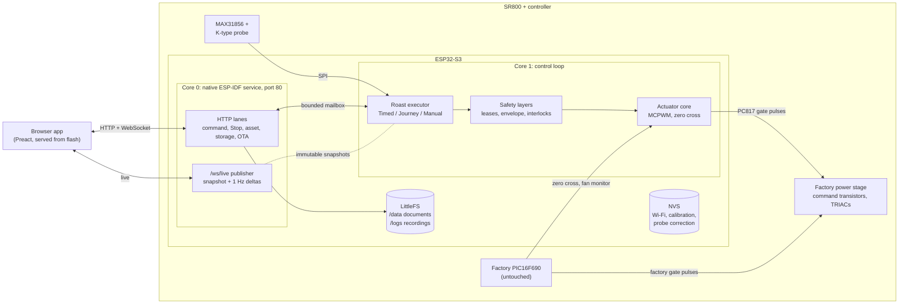

# Architecture

Crackle is a two-part system: firmware on an ESP32-S3 installed inside the roaster, and a
TypeScript web app that the firmware serves from its own flash. The firmware owns everything that
must survive a closed browser: actuation, safety, roast execution, the library, and the recordings.
The browser is an editor and a viewer.



## Principles

1. **The roaster runs the roast.** `POST /api/roast/start` hands over the whole plan: profile,
   calibration coefficients, batch mass, recording policy. The browser may then sleep, close, or
   reload. No roast tick ever originates in JavaScript.
2. **Safety lives below every command path.** A small, audited actuator core enforces the
   invariants that hold regardless of who asked: fan before heat, a minimum fan with heat, immediate
   heat-off, sensor freshness, sustained over-temperature latch, manual-use latch. Layers above it
   (instruction lease, runtime envelope, heat-on fan floor) bound hazards the core cannot see. There
   is no client-liveness rule: closing a browser is not an emergency.
3. **The controller is the database.** Profiles, bean lots, calibrations, and roast records are
   versioned documents on the device's flash. Every browser (a phone and a PC, say) sees the
   same library. A browser commits a change only after the device acknowledges a revision-checked
   write.
4. **Fail closed, never queue a surprise.** If the roaster is busy, stale, or unreachable, durable
   actions refuse visibly rather than being replayed later. Stop is never gated by anything.
5. **Every resource is bounded.** Sockets, subscribers, queues, request bodies, responses, and
   worker jobs have fixed, source-auditable capacities. Exhaustion returns 429/503; it never
   blocks the control loop.

## Firmware

The logic that can be tested on a desktop lives in `sr800_*` modules: the actuator core and phase
scheduler, zero-cross and sensor-fault qualifiers, journey control, the recording codec, the document
store, live deltas, and query parsing. Each has a native suite. `crackle.ino` is the integration
layer around them (task and route wiring, the executor's state machine, storage handlers, status
publication). It is one large file because it is mostly ESP-IDF glue that only runs on the target.
New logic that can be extracted goes into a module with its own test, not into the sketch. The web
app follows the same rule: `App.tsx` and the larger screens hold orchestration and markup, and the
logic they call is in `src/domain/` with unit tests.

### Control loop (core 1)

Arduino `loop()` owns the actuators, the roast executor, sensor decisions, and all mutable controller
state. It never touches a socket. Each tick it reads the thermocouple, advances the active program,
renews leases, and publishes an immutable snapshot for readers on the other core.

The **actuator core** (`sr800_actuator.*`, `sr800_mcpwm_phase_scheduler.*`) maps requested Fan/Heat
levels to firing delays and programs one MCPWM timer, synchronized to the mains zero cross, with two
comparators that raise and lower 100 µs gate pulses in hardware. Software observes the waveform; it
does not time it. See [actuator core](../firmware/actuator-core.md) and
[safety policy](../firmware/safety-policy.md).

The **roast executor** runs three modes:

| Mode | Plan | Control |
| --- | --- | --- |
| Timed | `fan:heat:seconds` steps | Open loop, device clock |
| Journey | Temperature zones: end temperature, nominal duration, Fan/Heat limits | 1 Hz model inversion + PI feedback on bean temperature; zones advance on measured attainment |
| Manual | Live operator Fan/Heat changes, journaled | Operator; can be saved afterwards as a timed profile |

Journey control is written once in TypeScript (`web/src/domain/journeyControl.ts`), the oracle the
browser uses for previews, and ported to C++ (`sr800_journey_control.*`). Generated cross-language
vectors replay thousands of control steps through both and fail on any divergence. See
[control and calibration](control-and-calibration.md).

### Network service (core 0)

One native ESP-IDF HTTP server owns port 80: parsing, keep-alive, WebSocket upgrades, and response
framing. Work is split into lanes so a slow phone download cannot delay Stop:

| Lane | Handles |
| --- | --- |
| Command workers (2) | Status/live reads and ordinary commands, through a bounded mailbox to the control loop |
| Stop | Reserved mailbox slot, queue, and higher-priority worker |
| Assets | Five PSRAM-first jobs stream gzip assets from flash; absorbs simultaneous cold loads |
| Storage | One worker owns every network-facing LittleFS operation, behind a small FIFO |
| OTA | The HTTP handler itself receives, preflights, writes, verifies, and commits the inactive slot |
| Live publisher | Fixed cadence, independent of subscribers: full snapshot on connect, then sequence-fenced deltas at most once per second |

Status and live data are formatted from immutable snapshots, so readers never lock the control loop.
See [network architecture](network-architecture.md).

### Storage

The 4 MB flash holds two 1.5 MB OTA application slots, an 896 KiB LittleFS volume, NVS, OTA data, and
a core-dump region. LittleFS has two tenants with one shared budget:

- **`/data`** holds opaque documents. The firmware owns only a 16-byte envelope (identity, version,
  length) and returns every other byte exactly as written; TypeScript owns the schemas. Writes are
  optimistic-concurrency checked: a stale base version is a 409.
- **`/logs`** holds `.crk` recordings: a 220-byte header, CRC-32, and delta-varint samples at about
  5 bytes per sample. Each recording carries its producer device and origin ID, the starting plan,
  the accepted instruction journal, the thermocouple correction applied at capture, and, for
  calibration passes, the exact test program.

Flash program/erase stalls the instruction cache and blacks out timing callbacks, so **flash writes
happen only while outputs are idle**. A roast reserves its provisional recording before actuation
and finalizes it after the outputs stop.

## Web app

A Preact + TypeScript single-page app, built by Vite, gzip-embedded into the firmware as
`crackle_bundle.h` (≈ 250 KB compressed). It is phone-first and needs no internet connection; it also
works over the controller's recovery access point.

| Layer | Responsibility |
| --- | --- |
| `src/components/` | Screens: Roast, History, Beans, Profiles, Controls, Calibrate, Reference, Settings |
| `src/domain/` | Pure logic: thermal model, journey control law, calibration fitting, profile validation, archive reconciliation |
| `src/data/` | Device-backed repository, IndexedDB mirror, backup/restore, `.crk` validation |
| `src/controller/` | HTTP client, live subscription, target resolution, retry rules |
| `dev/` | A full mock controller for development: plant simulation, WebSocket, archive, persistence |

The browser keeps a mirror of the library for instant rendering, namespaced by device identity, and
treats it as a cache. A view either has its complete data or says it is loading; only live roast
surfaces render incrementally.

## Lifecycle of a roast

```mermaid
sequenceDiagram
  participant B as Browser
  participant S as Storage worker
  participant L as Control loop
  B->>S: write run record (setup, bean, profile snapshot), outcome = running
  S-->>B: ack (revision N)
  B->>L: POST /api/roast/start (complete plan)
  L->>L: reserve provisional recording (outputs idle)
  L->>L: fan qualification → heat → executor ticks at 1 Hz
  L-->>B: /ws/live deltas (temperature, zone, solved levels)
  Note over B: browser may close; the roast continues
  L->>L: program ends → outputs off → finalize .crk
  B->>S: reconcile: attach recording to the staged run record
```

1. The browser writes the complete run record before Start; a refused write means no Start. Every
   browser sees the whole record from the first second.
2. The firmware validates the plan, reserves the recording, qualifies the fan, and runs the program.
3. Any browser that joins mid-roast backfills the in-progress recording and follows the live stream.
4. When the program ends, the recording is finalized while the outputs are idle, and the next
   reconciliation pass completes the staged record in place.

## Related documents

- [Design decisions](design-decisions.md): why the system has this shape.
- [Product specification](product-spec.md): behavior contract.
- [Controller integration](../web/docs/controller-integration.md): the browser/device contract, path by path.
- [Firmware reference](../firmware/crackle/README.md): API, storage format, build.
