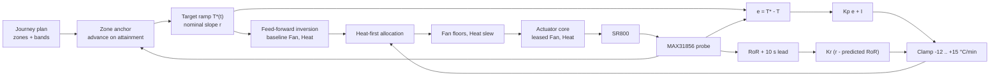

# Control and calibration

How Crackle turns a roast plan into Fan and Heat levels, and how it fits the thermal model the plan
relies on, written for a controls or firmware engineer. Sources:

| Concern | Source |
| --- | --- |
| Plant model | [`thermalModel.ts`](../web/src/domain/thermalModel.ts) |
| Journey law (oracle) and firmware port | [`journeyControl.ts`](../web/src/domain/journeyControl.ts), [`sr800_journey_control.cpp`](../firmware/crackle/crackle/sr800_journey_control.cpp) |
| Cross-language vectors | [`generate-journey-vectors.ts`](../web/scripts/generate-journey-vectors.ts), [`journey_control_vector_test.cpp`](../firmware/crackle/tests/journey_control_vector_test.cpp) |
| Replay, staging, and fitting | [`modelFit.ts`](../web/src/domain/modelFit.ts), [`thermalLog.ts`](../web/src/domain/thermalLog.ts), [`coefficientFit.ts`](../web/src/domain/coefficientFit.ts) |
| Starting coefficients, pre-start checks | [`estimatedBaseline.ts`](../web/src/domain/estimatedBaseline.ts), [`roastProgram.ts`](../web/src/domain/roastProgram.ts) |

The actuator layer beneath (zero-cross phase control, Heat leases, the 500 ms Fan qualification) is
in [`firmware/actuator-core.md`](../firmware/actuator-core.md) and
[`firmware/safety-policy.md`](../firmware/safety-policy.md).

## Design stance

The thermal model is a one-node estimate, not the truth: coefficients fitted at another mass, bean,
or room temperature are a starting guess. Control is layered so each layer may be wrong in a way the
next absorbs:

1. **Feed-forward** inverts the model to propose Fan and Heat, recorded every tick as the baseline.
2. **In-roast feedback** holds the nominal plan regardless of model error; it protects the batch.
3. **Post-roast residual**: the integral the feedback had to hold is a measured model bias, reported
   as the signal for the next calibration.

Two boundaries sit outside the model: zones advance only on measured temperature, and the firmware
enforces a whole-roast runtime envelope. Browser model checks are advisory, never a second safety
policy.

## The thermal model

### State equation

Bean temperature `T` evolves in °C per minute. The branch is selected only by the commanded pair, so
simulation, replay, fitting, the development mock, and the firmware inversion cannot choose different
physics:

```text
s = m_ref / m                         capacity scale, m_ref = 225 g
L = loss * (T - T_amb)                passive loss above ambient

heating        (Heat > 0):            dT/dt =  s * max(-5, 4 + (Heat/10)*G - (Fan/10)*F - L)
forced cooling (Heat = 0, Fan > 0):   dT/dt = -s * max( 8, (Fan/10)*C + L)
passive        (Heat = 0, Fan = 0):   dT/dt = -s * L
```

`4` is a fixed plant bias (`PLANT_BIAS_C_PER_MIN`). The model is integrated with one-second forward
Euler steps and never falls below ambient. With the shipped 5 s probe model (used by preview
simulation, not by replay), the rate passes through a first-order lag,
`RoR[k] = RoR[k-1]*(1-a) + target*a` with `a = 1 - e^(-1/5)`.

### Coefficients

| Symbol | Field | Meaning | Shipped estimate | Accepted range |
| --- | --- | --- | ---: | --- |
| `G` | `heaterGainCPerMinAt10` | Rise rate Heat 10 adds, before airflow and loss | 66 °C/min | 0.1–500 |
| `F` | `fanCoolingCPerMinAt10` | Rise rate Fan 10 removes while heating | 19 °C/min | 0.5–200 |
| `C` | `coolingFanCPerMinAt10` | Cooling rate Fan 10 produces with Heat off | 28 °C/min | 1–300 |
| `loss` | `thermalLossPerMinPerC` | Rate lost per °C above ambient | 0.17 /min | 0.005–2 |

The accepted ranges are identical in the browser fit bounds, the apply endpoint, NVS load, and Journey
start. `G` and `loss` are coupled (their ratio sets steady-state authority), so `G`'s lower bound is
only the solver's 0.1 authority floor.

The shipped values are an **estimated baseline**, not a measurement of any machine: the constants
that make this model reproduce a typical published SR800 roast (225 g from 20 °C, Fan 8 / Heat 8
easing to Fan 6 / Heat 7, then Fan 10 to cool) within 2.5 °C at three waypoints. With Fan and Heat
fixed, heating integrates to `T(t) = T_amb + (a/loss)(1 - e^(-loss*t))`, so two waypoints fix `loss`
and `a`; the `G`/`F` split comes from two fewer Fan levels adding about 4 °C/min. The UI labels a
model on these numbers as an estimate until a fit replaces it.

### Equilibrium and mass

Setting `dT/dt = 0` in the heating branch gives the temperature a pair holds at:

```text
T_ss(Fan, Heat) = T_amb + (4 + (Heat/10)*G - (Fan/10)*F) / loss
```

Batch mass scales the **complete** net rate around the 225 g reference. It therefore changes the
time constant (`1/(s*loss)` minutes) but cancels out of `T_ss`. Scaling only the heater term is
deliberately avoided: it makes a heavier batch settle at a lower temperature and invents a false
ceiling for exactly the batches where reachability matters most. Measured evidence is the check on
any ceiling; the shipped [sample recording](../data/captures/README.md#sample-roast-recording), for
example, crosses 223 °C at 14:53 and peaks at 225.0 °C.

## Roast modes

All three roast modes run on the controller. The browser defines a roast, hands the whole plan over
in one request, and is afterwards a spectator; closing it does not stop the roast.

| Mode | What runs | Model use | Ends on |
| --- | --- | --- | --- |
| Timed | 1–24 `Fan:Heat:seconds` steps, 1–1800 s each, on their exact durations | None | Last step, Stop, fault, envelope |
| Temperature Journey | 1–12 zones (endpoint 0–300 °C, nominal duration 5–1800 s, Fan and Heat bands), 1 Hz control | Inversion plus feedback | Final zone attained, Stop, fault, probe lost, envelope |
| Manual Roast | Operator instructions, each logged against temperature | None | Stop, 30-minute instruction lease, fault |

- **Timed** is open loop. Heat is re-requested every 5 s within a step, well inside the 30 s
  actuator Heat lease. A fan-only cooling step is appended when none was authored.
- **Journey** requires a complete applied coefficient set on the roaster. Batch mass is 20–2000 g.
  Ambient is the cold-junction reading at Start, captured once so the loss term does not drift as the
  board warms. Current and future zones can be edited mid-roast against an exact boot, session, and
  plan revision; control state carries across the patch.
- **Manual Roast** logs every accepted instruction. Planned next steps show a countdown but are never
  sent automatically; only the operator's Apply issues an instruction.

## Journey control law



### Zones, targets, and attainment

A zone completes only when the **measured** temperature attains its endpoint: `T >= endC` for a
rising zone, `T <= endC` for a cooling zone. The one exception is a hold zone (`|endC - startC| <=
0.5 °C`), where attainment is instantaneous and therefore meaningless, so its nominal duration
governs. A large overshoot may clear several endpoints in one tick, and each is recorded as attained.

Within a zone the target is the zone's own nominal ramp, anchored at the moment the roast actually
entered it:

```text
r     = (endC - startC) / duration * 60                        nominal slope, °C/min (0 for a hold)
T*(t) = startC + (r/60) * (t - t_entry),  capped at endC         (8)
```

The previous zone ended by attainment, so the target has no step at `t_entry`. Past the nominal
duration the target holds at `endC` while feedback pulls toward arrival, and feed-forward keeps the
authored slope so Heat does not collapse at the nominal zone end. The time axis stretches only at
zone boundaries; the target is never re-anchored to the measured temperature mid-zone, so a roast
that falls behind is held to its plan rather than re-planned around its own failure. Cooling
endpoints are floored at `ambient + 5 °C` before the plan is sent.

### Feed-forward inversion

Solving the heating branch for a wanted rate `r` at the current temperature, with `P = r/s` the
rate expressed at the 225 g reference:

```text
heat(fan, P)   = 10 * (P - 4 + (fan/10)*F + L) / G                           (1)
fan(heat, P)   = 10 * ((heat/10)*G - P + 4 - L) / F                          (2)
delivered(f,h) = s * (4 + (h/10)*G - (f/10)*F - L)                           (3)
```

Equation (1) has two unknowns, so the baseline chooses the **greatest airflow** whose required Heat
fits the zone: `fan(heatMax, P)` clamped into the Fan band, then (1) re-solved at that Fan and
clamped into the Heat band. Airflow improves circulation and evenness, so it is traded away only when
keeping it would make the rate unreachable. When a band clamps the solve, `delivered` (3) is the rate
the pair really produces, and corrections are measured from it.

Floors folded into the solve:

| Rule | Value | Scope |
| --- | --- | --- |
| Full airflow below 130 °C | Fan 10 while `T <= 130 °C`; overrides a lower authored Fan maximum | Journey heating zones |
| Heat on needs airflow | Fan ≥ 1.0 whenever Heat > 0; a lower Fan is lifted and Heat re-solved once | Every command path |
| Non-zero Fan minimum | Fan 0.1 | Every command path |
| Cooling zones | Fan 10, Heat 0, always | Journey cooling zones |

Above 130 °C the zone's own `fanMin` is the circulation setting. Bed circulation depends on the
batch, and there is no validated circulation law to justify a firmware floor overriding the profile.
Fan follows the solve immediately every tick, up or down.

### Feedback

The correction acts in **rate space** and is handed back through the same inversion, so it inherits
every band and floor:

```text
correction = clamp(Kp*e + Kr*eR + I, -12, +15)          °C/min
e          = T*(t) - T(t)                                °C
eR         = r - predictedRoR                            °C/min
I         += (Kp/Ti) * e * dt,  clamped to ±8
```

| Constant | Value | Reason |
| --- | ---: | --- |
| `Kp` | 3.0 °C/min per °C | Crossover near 0.05 rad/s (closed-loop time constant about 20 s) |
| `Ti` | 45 s | PI zero just below crossover; about 50° phase margin |
| `Td` | 10 s | Measured onset lag from actuator change to probe |
| `Kr` | `Kp*Td/60` = 0.5 | Derivative term on the measurement |
| Rate window `W`, lead `L` | 10 s, 10 s | Lead covers exactly one onset lag |
| Lead clamp | ±10 °C/min | Probe quantization cannot own the term |
| Rate history | 30 s, 32 samples | Fixed capacity for the firmware port |

Gains come from the plant: from correction `u` (°C/min) to temperature,
`T(s)/u(s) = 1 / (60 s (1 + 5 s))`. The factor 60 (minutes to seconds) is why `Kp = 1` would cross
over at only 1/60 rad/s. At `Kp = 3` the 5 s probe pole costs about 14° of phase; `Td` adds about 27°.

The rate term uses a lag-compensated estimate of where RoR is going:

```text
measuredRoR  = 60 * (T(t) - T(t - W)) / W                                   (6)
trend        = (measuredRoR(t) - measuredRoR(t - W)) / W
predictedRoR = measuredRoR + clamp(L * trend, ±10)                           (7)
```

At 1 Hz with `W = L = 10 s`, (7) is `2*RoR(last 10 s) - RoR(previous 10 s)`. No rate term exists
until one window of history exists, and no lead until two. The loop therefore relaxes as soon as the
trend turns, while measured RoR is still high, rather than after the position error has grown.

### Heat-first allocation

The maximum-airflow preference applies to the baseline only. A correction moves the actuators from
the baseline pair, spending Heat first:

```text
P_solve = delivered(fanBase, heatBase)/s + correction/s                    (4)
h0      = heat(fanBase, P_solve)
if h0 > heatMax:  fan = clamp(fan(heatMax, P_solve), fanMin, fanBase)
if h0 < heatMin:  fan = clamp(fan(heatMin, P_solve), fanBase, fanMax)
else:             fan = fanBase
heat    = clamp(heat(fan, P_solve), heatMin, heatMax)                       (5)
```

Fan moves only for the part Heat cannot deliver at its band edge. The reason is a plant property the
one-node model does not price: in heating mode the real effect of airflow can be an order of
magnitude larger than the fitted `F`, and it reaches the probe 8–10 s late, so a negative correction
routed to Fan overcools the batch before the probe shows it. For positive corrections the result is
identical to re-solving at maximum airflow.

### Authority, anti-windup, and missing samples

- **Asymmetric bounds.** +15 °C/min heating (about two Heat levels), −12 °C/min cooling, integral ±8.
  The cooling bound was measured by replaying a plan against plants hotter, slower, and more
  airflow-sensitive than their fit: with heater gain 20 % pessimistic, −6 ran away to 49 °C ahead of
  plan, −10 settled 2.5–3.5 °C ahead, −12 held within 1.5 °C. A larger bias is left visible as the
  refit's signal rather than chased with airflow the model cannot price.
- **Conditional integration.** If the command is blocked in the direction the correction pushes
  (Heat at the band edge, or the clamp binding) and the integral increment points the same way, the
  increment is discarded and the command re-solved. An opposing increment always applies, so a
  saturated integral can unwind.
- **Hold-off.** Nothing integrates in the first 20 s (the charge transient is a step the model does
  not describe), nor through cooling zones, whose Fan 10 / Heat 0 the correction never reaches, so
  no windup carries into a later heating zone.
- **Real timestamps.** `dt` comes from sample times, capped at 5 s; a gap over 15 s or a backwards
  clock integrates nothing and empties the rate history.
- **Holdover, not zero.** A missing reading zeroes the correction, freezes the integral, and solves
  feed-forward against the plan's temperature; a stale reading would drive a confident wrong
  correction. A sample counts only while at most 900 ms old (inside the actuator's 1 s telemetry
  gate), and 30 s of continuous holdover ends the roast with `sensor_lost`.

### Heat slew

Within heating zones Journey Heat moves at most 0.25 level per second in either direction, with at
most one second of allowance per tick so a delayed tick cannot bank a jump. The first solve, a
cooling zone, a lowered `heatMax`, Stop, faults, and safety reductions are immediate, and a slewed
Heat above zero still carries the Fan ≥ 1.0 rule. Slew blocks integration but is reported as
saturation only when a band or authority clamp also binds. Timed and Manual commands bypass it.

### Completion and the runtime envelope

- **Completed.** Attaining the final zone turns Heat and Fan off together. The firmware never
  synthesizes airflow after an automatic ending (the safety policy forbids it after faults and
  envelope breaches), so the profile must cool the beans; the pre-start check warns when it ends
  with Heat on.
- **Stop.** A Stop that ends a roast runs a 10 s Fan 10 / Heat 0 tail that any new command preempts.
- **Envelope.** An unreachable endpoint would otherwise hold its zone, renewing Heat, indefinitely.
  After `2 × nominal plan duration + 600 s` the firmware stops all outputs with `envelope_timeout`
  (Timed and Journey). Preview simulation uses the same envelope; zones have no private timeout.

## Cross-language verification

The TypeScript law is the oracle; the firmware runs a line-for-line C++ port with no Arduino,
ESP-IDF, or FreeRTOS types, so it compiles on the host. `generate-journey-vectors.ts` drives the real
`journeyControlStep` through twelve scenarios, often against a plant that deliberately differs from
the controller's model, and records the inputs and 29 output columns per step. The C++ test replays
every step and requires agreement to `1e-4` on every field.

| Scenario | Steps | Pins |
| --- | ---: | --- |
| `nominal` | 901 | Attainment, maximum-airflow solve, 130 °C floor, fold-back |
| `weak_heater` | 901 | Plant 20 % weaker than modelled; integral holds the bias |
| `saturated_windup` | 781 | Unreachable ramp; integral freezes, then resumes |
| `hold_zone` | 241 | Hold zone governed by duration |
| `mid_roast_plan_patch` | 541 | Plan replaced at 120 s; state continues |
| `non_reference_mass` | 421 | 300 g capacity scaling |
| `cool_then_heat` | 421 | Cooling to heating; integral held while cooling |
| `irregular_cadence` | 93 | 1/2/7/1/12 s gaps; `dt` clamps |
| `heavy_mass_immediate_reduction` | 1021 | Fan drops whole levels in one tick at 240 g |
| `heat_on_fan_floor` | 301 | Fan ≥ 1.0 with Heat on |
| `overshoot_lag_recovery` | 781 | Airflow-sensitive plant, 8 s dead time, 10 s lag; Heat-first, −12 bound |
| `dropout` | 901 | Probe dead 400–430 s; holdover and resume |
| **Total** | **7,304** | |

A mismatch means the port is wrong. The vectors are regenerated only when the TypeScript law is
changed deliberately, never to make a failing comparison pass:

```bash
# from web/
npx vite-node scripts/generate-journey-vectors.ts
# from firmware/crackle/tests/
out=$(mktemp -d)
g++ -std=c++17 -I fakes -I ../crackle journey_control_vector_test.cpp ../crackle/sr800_journey_control.cpp -o "$out/vectors" && "$out/vectors"
```

The `journeyControl.*.test.ts` suites hold the behavioural evidence: with the model's heater gain
±20 % or loss +30 % wrong, the loop stays within 2 °C of plan after settling while the integral
carries the bias; across an unreachable stretch the integral does not accumulate and recovery
overshoots by less than 3 °C. See [`testing.md`](testing.md).

## Calibration

Calibration fits the four coefficients to recordings of this roaster. Preview runs in the browser;
only an explicit Save and an idle, acknowledged Apply change the coefficients the roaster holds.

### Evidence types

| Evidence | What it is | What it constrains |
| --- | --- | --- |
| Empty-chamber baseline | A device-run Fan × Heat staircase with no beans; default grid Fan 1, 4, 7, 10 × Heat 1, 5, 10, 300 s step cap, 20 s minimum dwell, 20 s settle window, 0.2 °C settle band, then forced-cooling and passive-decay tails | Airflow terms, coarse equilibrium and transition maps |
| Loaded roast | Any recorded roast (Manual Roast is the usual source) with its batch mass, 1 Hz log | Heater gain and bean-side loss, the regime the model is asked to predict |

An empty pass measures the chamber, a different regime: a chamber-scale set driven through the bean
model settles far below roast temperatures. Coefficient sets carry no regime tag, so pre-roast model
checks use only the set applied on the roaster. Baseline staging uses the model's own balance:

```text
loss       = 60 / tau_passive                  fan-off, heat-off decay tail (tau in s)
G          = 10 * slope * loss                 slope = steady rise per Heat level at one Fan
F          = 10 * loss * (rise_lo - rise_hi) / (fan_hi - fan_lo)     same-Heat hold pairs, averaged
C          = (rate_forced - loss * meanRise) * 10 / fan                forced-cooling tail
```

Bias and airflow cancel when differentiating in Heat; same-Heat pairs isolate airflow. A coefficient
whose input is missing is reported, not staged. Settled values are curve-fitted rather than taken
from the settle flag, and a step cut short is marked extrapolated or unreliable. The calibration
screen's time-to-temperature heatmaps cost each move `tau * ln(|ΔT| / band)` with `tau = 1/loss`,
using a 2 °C band; at `loss = 0.174` a 0.2 °C band would add `tau * ln(10) ≈ 13.2 min` of pure
mathematical tail to every cell.

### Ambient

Recording ambient is the **lowest cold-junction reading in the final fifth** of the log, falling back
to the lowest reading anywhere, then to the stored ambient or 24.5 °C. The junction never reads below
true ambient and is often heat-soaked after a restart, so the coolest late reading is least wrong.

### Objective

The objective is the **open-loop replay RMS**: recorded Fan and Heat run through the model in
one-second steps, seeded once from the first reading and never re-anchored. A closed-loop replay
would pull the model back to the truth every step and flatter it. Several logs fit jointly by pooling
squared errors, each replayed with its own seed, ambient, and mass. For loaded roasts the first
**180 s** are simulated but not scored: the charge turnaround is a structural error of a one-node
model and would drown the later evidence. A log too short to score after that window is not used.

### Search and identifiability

The search is a deterministic Hooke-Jeeves pattern search: probe each free coefficient up and down,
then try continuing along the sweep's overall displacement, halving the step when a sweep improves
nothing (initial step 35 % of `max(|value|, scale)`, scales 60 / 30 / 30 / 0.2, stop below 0.04 % or
after 200 sweeps). The pattern move matters because `G` and `F` lie along one correlated valley in a
roast log; coordinate descent zig-zags across it and stops at the wrong point with a respectable RMS.

Three mechanisms keep a small RMS from passing for a good fit:

- **Excitation report.** A log that never changes Heat cannot separate `G` from loss; one that never
  moves Fan while heating says nothing about `F`; Fan and Heat that only move together cannot be told
  apart; no fan-on, heat-off tail leaves `C` unconstrained. These warnings travel with the fit.
- **Baseline pinning.** A selected empty-chamber baseline's `F` and `C` are frozen during the
  search (clamped to the accepted range, at apply precision) and the loaded logs fit `G` and loss
  against them. Swapping them in after a free fit is not equivalent: the free `G` compensates for its
  own airflow estimate, and the combined set's error would never have been measured.
- **Multi-start.** The search also runs from four seeds spread along the most correlation-prone free
  coordinate: `F` at 0.5, 5, 35, 100, or `G` at 5, 30, 120, 400 when `F` is pinned. Solutions within
  `max(1 °C, 40 %)` of the best RMS are near-best. A coefficient whose near-best range is wider than
  `max(absolute, 50 % of midpoint)` (absolute 15 for `G`, 0.08 for loss, 10 for airflow terms) is
  unstable; Save and Apply are refused unless a pinned baseline resolves it, and the refusal names
  the missing evidence (a complete fan-only cooling tail, a baseline with same-Heat Fan changes).

### Selecting evidence

- Use complete roasts started from a cold chamber. The model has no state for heat stored in the
  walls or element, so a warm or hot start biases the fit; the
  [sample recording](../data/captures/README.md#sample-roast-recording), which begins at 53.5 °C, is
  such a warm start. Partial roasts lack the full trajectory and are left out as well.
- The fit picker includes a log by default only when it has at least 30 readable samples and a
  recorded batch mass. It never hides a log; it states why one is excluded and leaves the choice to
  the operator.
- A saved fit fingerprints its inputs. Editing their measurements or deleting one marks the fit
  stale; a refit saves a new calibration and keeps the old one as the record of what was applied.

### Feasibility warnings

Before a Journey starts, each rising zone is checked against the coefficients the roaster holds, or
not at all. The model ceiling is `T_ss` at maximum Heat and the lowest Fan the zone and floors allow.
An endpoint above it produces a warning stating the endpoint, the ceiling, the zone's bands, the
applied fit's replay RMS, and the highest temperature the fit's own source recordings reached inside
those bands; matching measured evidence overrides the ceiling. Cooling zones are checked against
ambient. A fit with a large RMS, or drawn from batches unlike the planned one, makes the ceiling an
uncertain extrapolation, so these are warnings, never blockers: the roaster still attempts the
target and the firmware envelope remains the authority. Missing applied coefficients, malformed
plans, sensor faults, and an active operation are the real blockers.

### Post-roast residual

The mean integral term over usable samples estimates the feed-forward bias in °C/min (positive: the
model under-heats). Holdover and saturated samples are counted, not averaged, and only middle zones
contribute: the first zone is a charge ramp usually authored steeper than any roaster can follow,
and a trailing cooling zone is governed by heat leaving the beans. An RMS close to the mean is a
steady offset; far above it is a shape error no single coefficient fixes.

## What the model does not capture

| Gap | Consequence in the design |
| --- | --- |
| Stored chamber heat (hot walls, warm element) | Cold-start evidence rule; opening-turnaround exclusion |
| Airflow authority in heating mode, and its delay | Heat-first allocation; asymmetric −12 bound |
| Probe dynamics (replay and fitting use no lag) | Coefficients absorb the lag; preview re-applies 5 s |
| Bean properties beyond mass | Volume and bulk density are recorded covariates only; no validated density law |

Each gap is bounded by measurement, not by the model. Operator workflows are in
[`web/docs/user-workflows.md`](../web/docs/user-workflows.md); the normative contract is
[`product-spec.md`](product-spec.md).
