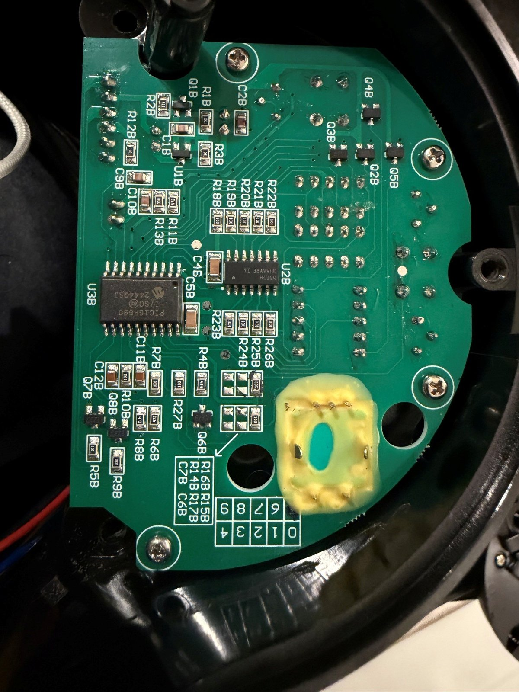

# SR800 hardware

The Fresh Roast SR800 is a fluid-bed home coffee roaster: a universal-motor blower lifts the beans
in a glass chamber while a resistive element heats the air. A PIC16F690 on the front-panel board
runs the stock Fan / Power / Timer interface and fires both loads with TRIAC phase-angle control.

Crackle leaves all of that in place. An ESP32-S3 inside the base reproduces the PIC's fan and heater
trigger commands through two optocouplers wired in parallel with the factory driver transistors,
reads bean temperature from a thermocouple in the bean bed, and watches for manual use of the
factory controls. Nothing is cut. With the controller idle or unpowered, the roaster is stock.

## Documents

| Document | Contents |
| --- | --- |
| [Reverse engineering](reverse-engineering.md) | How the electronics were studied without removing the UI board, and how each finding chose the interface |
| [Board teardown](board-teardown.md) | Component identification, PIC16F690 pin roles, and photographs |
| [Power-stage interface](power-stage-interface.md) | Measured trigger and zero-cross signals, command topology, and the selected optocoupler interface |
| [Display interface](display-interface.md) | Decoding the 74HC164 display bus: glyphs, blink, and mode signatures |
| [Installation](installation.md) | Parts, exact wiring, pin map, thermocouple mounting, first flash, and commissioning |
| [Safety checklist](safety-checklist.md) | Electrical and behavioral checks after installation or rework |
| [`display-glyph-map.json`](display-glyph-map.json) | Machine-readable segment-byte map |

## Key facts

| | |
| --- | --- |
| Mains | 120 V / 60 Hz (the zero-cross reference runs at ≈ 120 edges/s) |
| Factory controller | PIC16F690 (U3B): pin 11 heater trigger, pin 12 fan trigger, pin 17 zero cross |
| Command inputs | Active-low, open-collector, ≈ +12 V idle |
| Controller | Waveshare ESP32-S3-Zero (4 MB flash, 2 MB PSRAM), isolated 5 V USB supply |
| Output interface | Two PC817C phototransistors in parallel with the factory transistors, 100 µs gate pulses generated by MCPWM hardware |
| Temperature | MAX31856 + K-type probe through the chamber lid at bean-bed height |

> [!WARNING]
> The factory logic ground is potentially mains-referenced, and the installed controller shares it.
> Never connect a computer, serial adapter, or grounded instrument to the controller while the
> roaster is plugged in. See [installation](installation.md).

The raw evidence behind these documents (logic captures, timing proofs, and acoustic fan
calibration) is in [`../data/`](../data/README.md).
