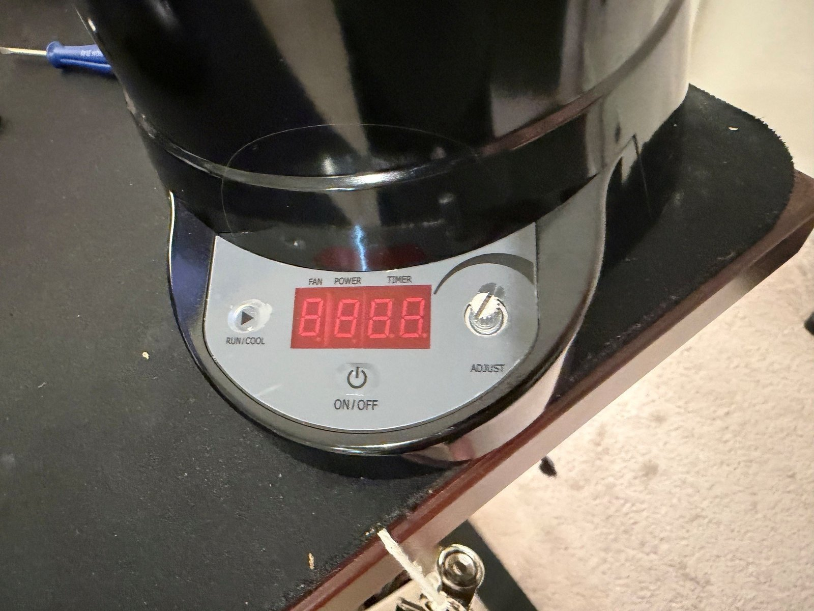
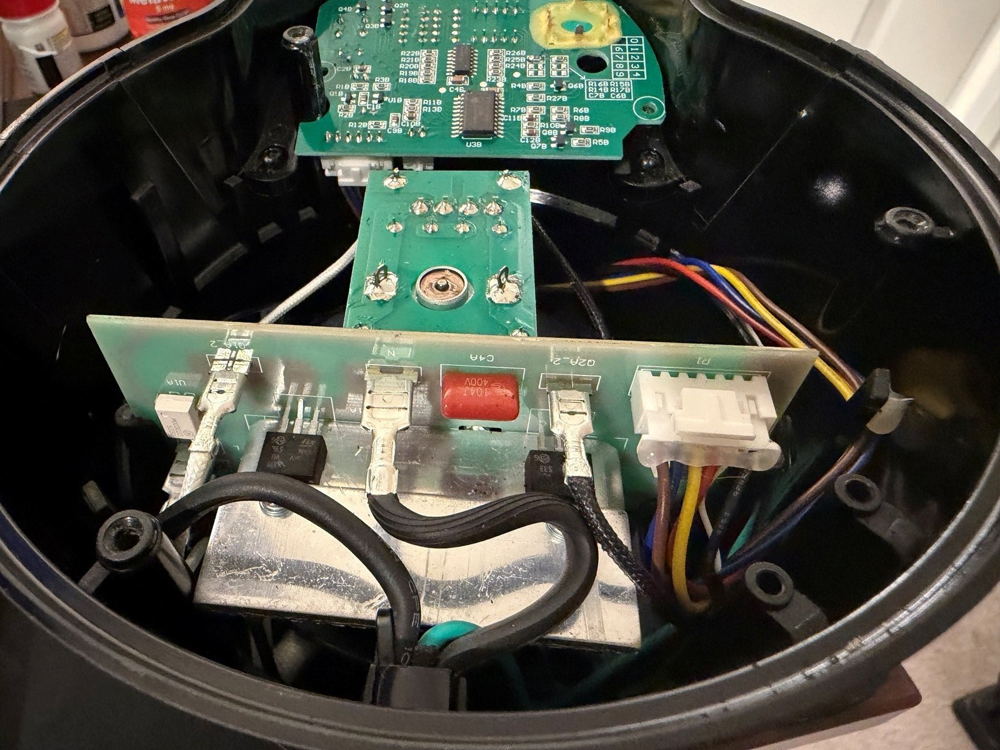
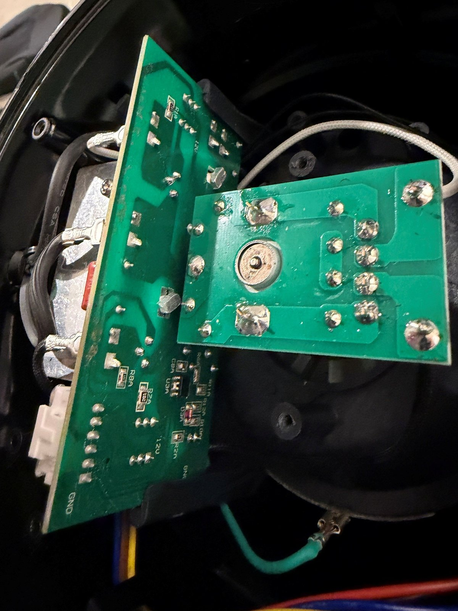
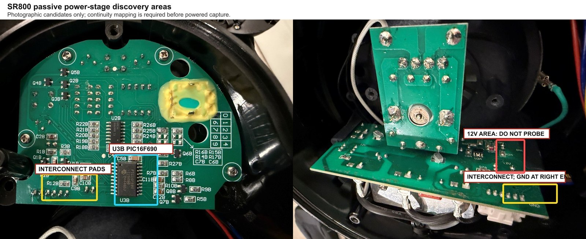

# SR800 board teardown

Component identification for the Fresh Roast SR800 control electronics, made in place from
photographs, visible IC markings, and accessible solder joints. The UI board was never removed: the
rotary encoder and printed control face make removal destructive.

Confidence labels: **verified** (readable or measured), **strong inference** (placement and traces
support it), **unknown** (not established).

## Front panel



A four-digit seven-segment display labelled `FAN`, `POWER`, `TIMER`, two momentary buttons
(`RUN/COOL`, `ON/OFF`), and a rotary `ADJUST` encoder with push. Five electrical actions in total:
encoder A, encoder B, encoder push, Run/Cool, On/Off.

## UI board


| Part | Identification | Confidence |
| --- | --- | --- |
| `U3B` | Microchip PIC16F690-I/SO, 20-pin SOIC: the factory controller | Verified |
| `U2B` | TI 74HC164 serial-in/parallel-out shift register | Verified |
| `Q2B`–`Q5B` | Four SOT-23 digit drivers for the multiplexed display | Strong inference |
| Six-pad edge connector | Low-voltage interconnect to the power board | Verified by trace following |

Display data path:

```text
                 serial data + clock
PIC16F690  ------------------------------>  74HC164
    |                                         |
    | four digit selects                      | eight segment outputs (active low)
    v                                         v
Q2B–Q5B digit switches  ---------------->  4-digit LED display
```

The 74HC164 has no output latch, so the PIC blanks a digit while shifting its next byte, then
enables it. Decoding is described in [display interface](display-interface.md).

### PIC16F690 pins of interest

Pin functions are from the datasheet. Roles are from measurement.

| Pin | Datasheet function | Measured role |
| ---: | --- | --- |
| 1 | VDD | 5 V logic supply |
| 4 | RA3 / MCLR / VPP | Configured as the RA3 digital input, **not** reset. Pulling it low does not reset the PIC. |
| 8 | RC6 / SS | Routed to the interconnect; inactive in every observed state |
| 9 | RC7 / SDO | Routed to the interconnect; inactive in every observed state |
| 10 | RB7 / TX | ~124 Hz display digit-select waveform |
| 11 | RB6 / SCK | **Heater trigger command** |
| 12 | RB5 / RX | **Fan trigger command** |
| 17 | RA2 / INT | **Mains zero-cross reference**, ~60 Hz square wave |
| 18, 19 | ICSPCLK / ICSPDAT | Programming pins (unused) |
| 20 | VSS | Factory logic ground: the controller's signal reference |

SOIC pin 1 is at the upper-left of `U3B` in the upright component-side photograph.

## Power board



The power board carries the mains spades (`L`, `N`), two heatsinked TO-220 power switches for the
fan and heater loads, a 0.1 µF / 400 V film capacitor, a small optocoupler-style package, the
harness connector to the blower and heater, and the low-voltage interconnect to the UI board.
Silkscreen marks `12V` and `GND` next to the interconnect.



Downstream of PIC pins 11 and 12, a factory transistor per channel drives the power board's command
input. Each transistor's collector idles near **+12 V** and is pulled low by a trigger pulse: the
power-stage command inputs are active-low and open-collector. This is the node Crackle parallels
(see [power-stage interface](power-stage-interface.md)).

| Property | Finding | Confidence |
| --- | --- | --- |
| Command polarity | Active-low open collector, idle ≈ +12 V | Verified (powered measurement) |
| Factory 5 V rail capacity | Cannot power an ESP32-S3 with Wi-Fi | Verified (repeated resets, display dimming) |
| Isolation of logic from mains | No complete isolation path visible | Unknown: treat the logic domain as mains-referenced |
| `GND` silkscreen | Circuit common, not protective earth | Verified label; earth status unknown |



The annotated photograph shows the interconnect pads used for discovery and the `12V` area that is
never probed. The PIC-side pins were ultimately easier and safer to probe than the interconnect.

## Remaining unknowns

These do not affect the selected interface:

- Exact blower motor and rectifier topology. A motor-efficiency judgement (phase control vs. a DC
  PWM conversion) would need part markings this teardown did not expose.
- Whether the PIC enables code protection. A read-only ICSP dump was never needed.
