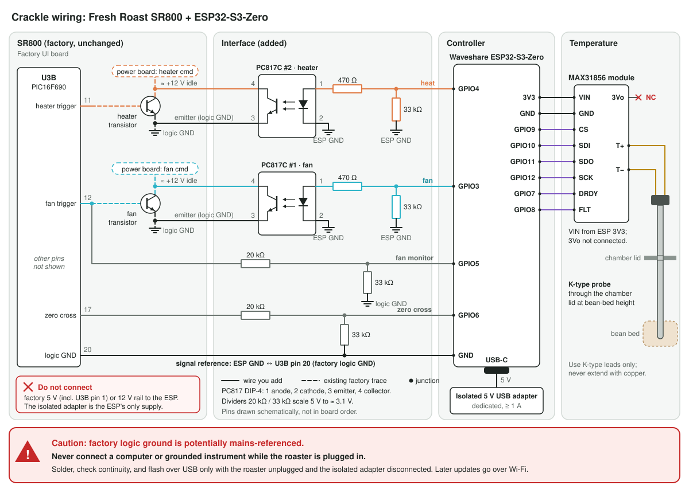
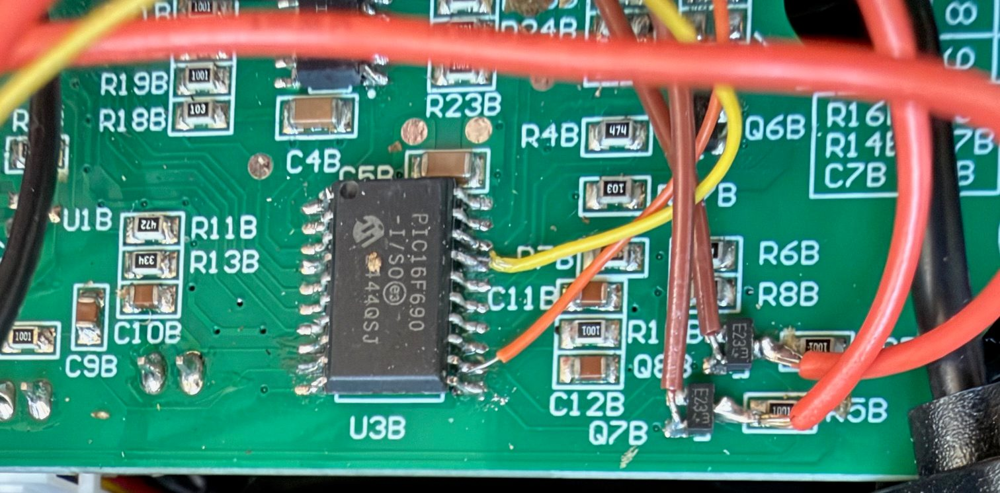
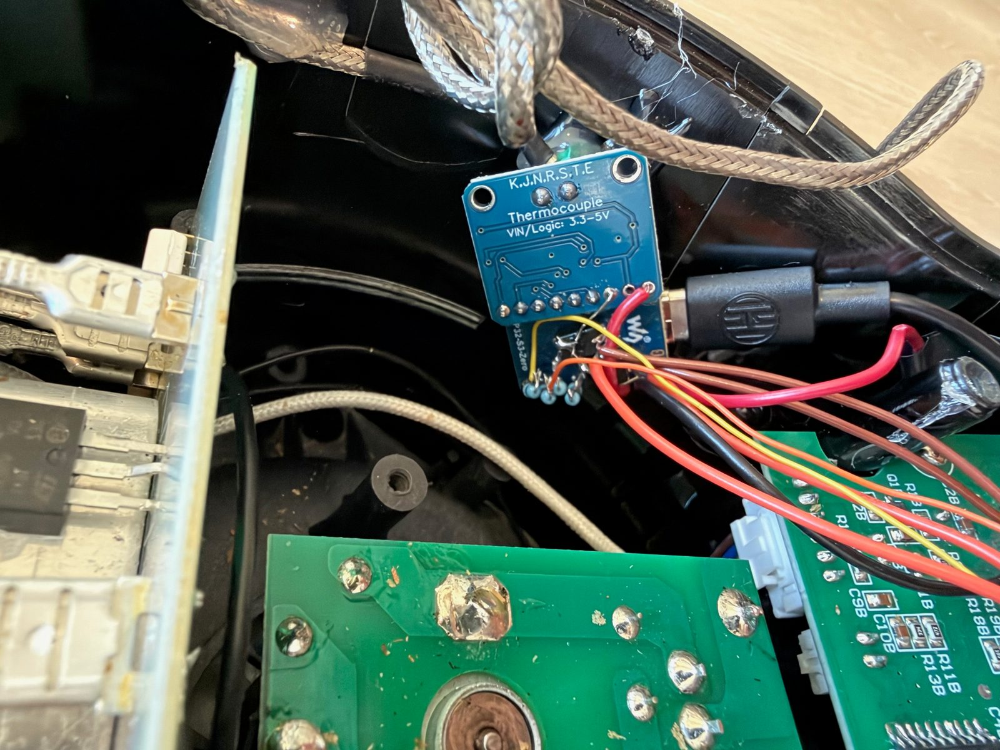
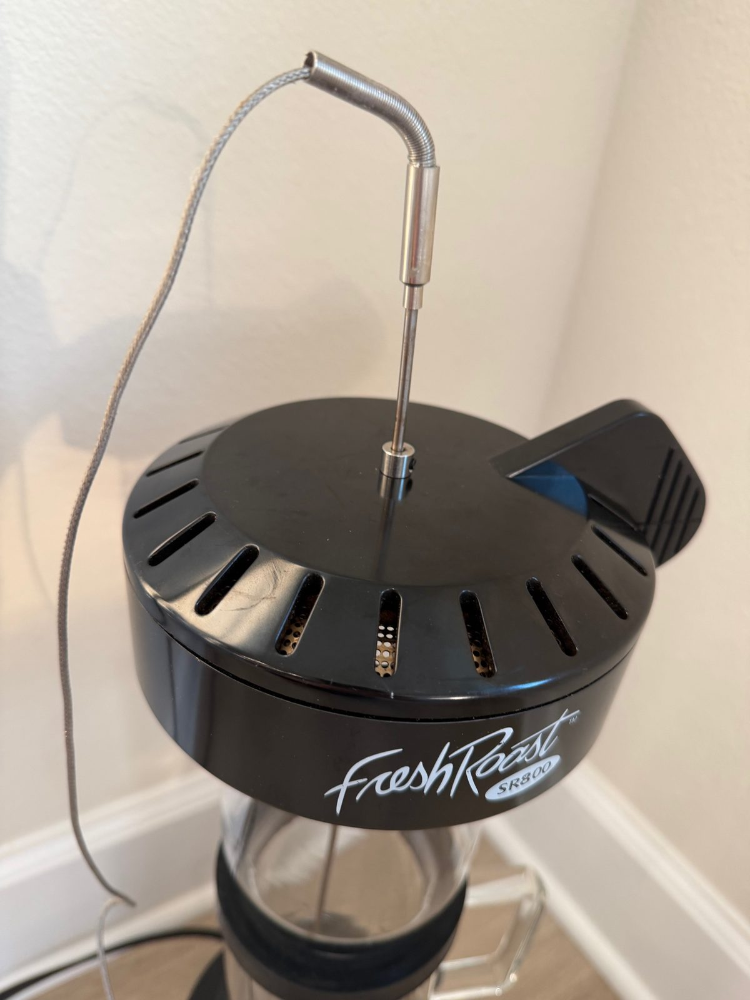

# Installing the controller

How to build the Crackle controller and patch it into a Fresh Roast SR800. Read
[power-stage interface](power-stage-interface.md) first: it explains what each connection does.

Crackle has been developed and tested only on a 120 V / 60 Hz SR800. The phase timing assumes 60 Hz;
do not fit it to a 230 V / 50 Hz model without re-measuring that model's power stage.

> [!WARNING]
> This modification works inside a mains-powered appliance. The factory logic ground the
> controller references is **potentially mains-referenced**. Do all soldering, continuity checks,
> and USB flashing with the roaster unplugged. **Never connect a computer, serial adapter,
> programmer, oscilloscope, or any grounded instrument to the controller while the roaster is
> plugged in.** Firmware updates after installation go over Wi-Fi. If you are not comfortable
> working on mains equipment, do not attempt this.

## Overview



Two PC817 optocouplers fire the factory fan and heater transistors, two resistor dividers bring the
zero-cross and factory fan-trigger signals down to 3.3 V logic, and a MAX31856 reads the K-type bean
probe over SPI. The ESP32 is powered only by its own isolated USB adapter; its ground joins the
factory logic ground (U3B pin 20) as the signal reference. The tables below give every connection.

## Parts

| Qty | Part | Notes |
| ---: | --- | --- |
| 1 | Waveshare ESP32-S3-Zero | 4 MB flash, 2 MB PSRAM (PSRAM is required) |
| 1 | Isolated USB charger, 5 V / ≥ 1 A | Dedicated controller supply, mounted inside the roaster and wired to its mains input |
| 2 | PC817C optocoupler, DIP-4 | Fan and heater command pull-downs |
| 2 | 470 Ω resistor | PC817 LED current limit |
| 2 | 33 kΩ resistor | GPIO3/GPIO4 off-at-boot pull-downs |
| 2 | 20 kΩ resistor | Upper leg of the zero-cross and fan-monitor dividers |
| 2 | 33 kΩ resistor | Lower leg of those dividers |
| 1 | MAX31856 module with onboard regulator | Thermocouple converter, SPI |
| 1 | K-type thermocouple, stainless-sheathed probe, 3.2 mm diameter | Mounted through the chamber lid. 300 mm suits an SR800 with the extension tube; a standard chamber needs a shorter probe, so measure from the lid to bean-bed height first |
| 2 | Set-screw shaft collars, 4 mm bore, stainless steel | Probe stops, one above and one below the chamber lid |
| — | Insulated hookup wire | Optocouplers and resistors solder directly to the ESP32-S3-Zero's pads; secure the assembly so nothing is loose or can touch mains, moving, or hot parts |

Optional: the reference build sits on the 3D-printed
[Fresh Roast SR800 Coffee Roaster Tilting Base](https://makerworld.com/en/models/3018852-fresh-roast-sr800-coffee-roaster-tilting-base) from MakerWorld, printed in its
backward-leaning version with a section cut from the top so the probe cable can pass through.
Its 3° tilt improves bean movement and circulation for a more consistent roast.
Crackle does not need it.

## Wiring



<sub>The interface wires on the factory control board, at the PIC16F690 (U3B) and the command
transistors beside it. Nothing on the board is cut or removed.</sub>

### Power and reference

| From | To |
| --- | --- |
| Isolated charger | ESP32 USB-C (or `5V` / `GND` pads) |
| ESP32 `GND` | Factory logic ground, U3B pin 20 |

Do **not** connect U3B pin 1 or any factory 5 V point to the ESP32 `5V` pin: the factory rail
cannot carry the ESP32 and causes reset loops. Never parallel the charger with the factory rail.
Nothing connects to the `12V` rail.

### Fan and heater outputs

PC817 DIP-4 pinout, viewed from the top with the pin-1 mark at upper left: 1 anode, 2 cathode,
3 emitter, 4 collector. Confirm against the purchased part's datasheet.

| Function | Connection |
| --- | --- |
| Fan LED | ESP GPIO3 → 470 Ω → fan PC817 pin 1; pin 2 → ESP GND |
| Fan off-at-boot | 33 kΩ from GPIO3 to ESP GND |
| Fan output | Fan PC817 pin 4 → collector pad of the factory transistor driven by U3B pin 12; pin 3 → that transistor's emitter (logic ground) |
| Heater LED | ESP GPIO4 → 470 Ω → heater PC817 pin 1; pin 2 → ESP GND |
| Heater off-at-boot | 33 kΩ from GPIO4 to ESP GND |
| Heater output | Heater PC817 pin 4 → collector pad of the factory transistor driven by U3B pin 11; pin 3 → that transistor's emitter |

Before soldering, use continuity mode to identify each factory transistor's emitter (the
ground-side pad). The other switched pad is the collector, which measures ≈ +12 V in Standby.
Connect the PC817 collector to that **command node**, never directly to the +12 V rail, a
transistor base, or PIC pins 11/12.

### Passive inputs

```text
U3B pin N ---- 20 kΩ ----+---- ESP GPIO
                         |
                       33 kΩ
                         |
factory logic GND -------+
```

| Signal | Source | ESP32 |
| --- | --- | --- |
| Zero-cross | U3B pin 17 | GPIO6 |
| Factory-fan monitor | U3B pin 12 | GPIO5 |

### Thermocouple

| MAX31856 | ESP32-S3-Zero | Notes |
| --- | --- | --- |
| `VIN` | `3V3` | Leave the module's `3Vo` regulator output unconnected |
| `GND` | `GND` | |
| `CS` | GPIO9 | Held high from early boot |
| `SDI` / `MOSI` | GPIO10 | SPI mode 1, 1 MHz |
| `SDO` / `MISO` | GPIO11 | |
| `SCK` | GPIO12 | |
| `FLT` | GPIO8 | Active low |
| `DRDY` | GPIO7 | Active low |
| `T+` / `T-` | K-type leads | Never extend with ordinary copper wire |

Keep the converter close to the thermocouple termination and away from heater wiring, fan power
wiring, the command transistors, the ESP32 antenna, and hot exhaust.

| | |
| --- | --- |
|  |  |
| The MAX31856 and ESP32-S3-Zero, mounted together near where the probe cable comes into the base. The USB-C cable is the controller's power. | The probe through the lid, held by a shaft collar above the lid and a second below it. |

**Probe placement.** Drill the chamber lid and pass the probe through it, clamped by two set-screw
shaft collars, one above and one below the lid, so the tip sits at bean-bed height, clear of the
glass wall and any metal. Use only mechanical retention or materials rated for 260 °C or more at
the lid: exhaust air runs hot. Readings depend strongly on placement, so recordings made with the
probe in different positions are not comparable.

### Mounting and the charger's supply

On the reference build, the ESP32-S3-Zero and the MAX31856 are hot-glued to the inside wall of the
base (see the photos above). The isolated USB charger is wedged in place inside the base, its mains
input wired directly to the mains connections on the roaster's power board, with the wires
hot-glued to the wall. Keep all of it clear of the heater, the fan, and hot exhaust, and do mains
wiring only with the roaster unplugged and only if you are qualified to work on mains equipment.

Because the charger runs from the roaster's mains, the controller is on whenever the roaster is
plugged in. Unplugging the roaster is how you power-cycle it, for example to clear a latched fault.

### Pin map

| GPIO | Direction | Function |
| ---: | --- | --- |
| 3 | Out | Fan PC817 LED (U3B pin-12 channel) |
| 4 | Out | Heater PC817 LED (U3B pin-11 channel) |
| 5 | In | Factory-fan monitor (U3B pin 12, divided) |
| 6 | In | Zero-cross (U3B pin 17, divided) |
| 7 | In | MAX31856 `DRDY` |
| 8 | In | MAX31856 `FLT` |
| 9 | Out | MAX31856 `CS` |
| 10 | Out | MAX31856 `SDI` |
| 11 | In | MAX31856 `SDO` |
| 12 | Out | MAX31856 `SCK` |

GPIO3 is an ESP32-S3 strapping pin, but the stock chip ignores it for JTAG selection unless the
corresponding eFuse is burned; do not change eFuse strapping. Avoid GPIO0, 19/20, 21, 43/44, and
45/46 for additions (boot, native USB, onboard LED, UART, strapping).

## First flash

The first install is a serial flash, easiest before the controller goes into the roaster; every
later update is over Wi-Fi.

1. **Unplug the roaster from mains.** If the controller is already installed, open the base, unplug
   the controller's USB cable from the charger, and connect that cable to the computer.
2. Download `crackle-<version>-serial.zip` from the
   [latest release](https://github.com/triwebb1/crackle/releases/latest), check it against the
   release's `SHA256SUMS.txt`, unzip it, and follow its `FLASHING.md`. It writes the bootloader,
   partition table, OTA selector, and application at explicit offsets with `esptool`.
   To build the firmware yourself instead, see
   [build and verify](../firmware/crackle/README.md#build-and-verify) (the board options
   `PartitionScheme=custom`, `PSRAM=enabled`, and `EraseFlash=none` are mandatory) and
   [serial flash](../firmware/crackle/README.md#serial-flash-recovery-only).
3. Disconnect the computer **before** restoring the charger or mains: plug the USB cable back into
   the charger and close the base before plugging the roaster back in.

## Network setup

1. Power the roaster. With no saved network, the controller opens a Wi-Fi access point named
   `Crackle` (password `freshroast`).
2. Join it and open `http://192.168.4.1/probe`, a diagnostic page. Use only its **Network**
   section: enter the home Wi-Fi name and password. Leave the hardware test buttons alone.
3. Rejoin the home network and open `http://crackle.local/` (or the address the probe page
   reports). The recovery access point turns itself off once the home connection is stable and
   returns if the network is lost.

The controller has no login: anyone on the LAN can operate it. Keep it on a trusted network.

## Commissioning

Run these once after installation and after any hardware rework, with the factory display showing
four dashes (Standby):

1. Before applying mains: GPIO3→GND and GPIO4→GND measure ≈ 33 kΩ; neither unpowered PC817's
   collector–emitter path conducts; no solder bridges or pinched wires.
2. `GET /api/status`: firmware version as expected, `actuator.fault` is `none`,
   `manual_conflict_latched` is `false`, zero-cross healthy, MAX31856 configured with plausible
   readings.
3. Warm the probe tip: the reading must rise. If it falls, swap `T+`/`T-` with all power removed.
4. In **Controls**, run Fan 0.1 for a few seconds, then Fan 10. The blower must start smoothly with
   no rough pulsing and stop when commanded.
5. Run Fan 1 with Heat 0.1 for ten seconds. Heat must wait for 500 ms of established fan. On Stop,
   Heat drops immediately.
6. Check the probe offset. The firmware applies a −3.0 °C correction by default, measured on the
   reference build (its probe read about 103 °C in boiling water). Put the probe tip in boiling
   water: it should read close to 100 °C at sea level. If it does not, set the correction under
   **Settings** so it does (−25 to +25 °C). Recalibrate after changing it, because the thermal model
   is fitted to corrected readings.
7. After the test, start the factory fan by hand. The controller must disable itself (red
   `DISABLED` banner) and refuse commands until power is cycled, while the factory controls keep
   working.

The complete checklist, including a longer soak, is in [safety checklist](safety-checklist.md).

**If the overheat limit trips during a normal roast or calibration.** The limit (`kOvertempDisableC`
in `crackle.ino`) is set above the hottest reading a correctly placed probe sees in normal use, so a
trip without smoke or flame usually means the probe reads hotter than the beans: check that its tip
sits at bean-bed height and well away from the heating element. If the placement is right and your
roaster genuinely runs hotter (a different heater, for example), raise `kOvertempDisableC` by the
smallest amount that clears your hottest normal reading and build your own image. Keep it well
below the temperature at which chaff or beans could ignite; the limit exists to stop a fire before
it starts.

## Updating

Download `crackle-<version>-ota.bin` from the
[latest release](https://github.com/triwebb1/crackle/releases/latest), open
`http://crackle.local/update`, and upload it.
The updater writes the inactive A/B slot, validates the complete image, and only then selects it
for boot; an interrupted upload leaves the running firmware selected. NVS settings, calibration,
and the on-device library and recordings are preserved. Upload only while outputs are idle.

**If the controller can't be reached.** When it loses its home network, the controller reopens the
`Crackle` recovery access point after about 15 seconds (while idle). Join it to re-enter the network
details as in [network setup](#network-setup), or to update at `http://192.168.4.1/update`. A
serial flash, which means opening the roaster, is needed only when the controller can't be reached
on either network, for example after a firmware that fails to start: follow
[first flash](#first-flash), which moves the controller's USB cable from the charger to a computer
with the roaster unplugged.
